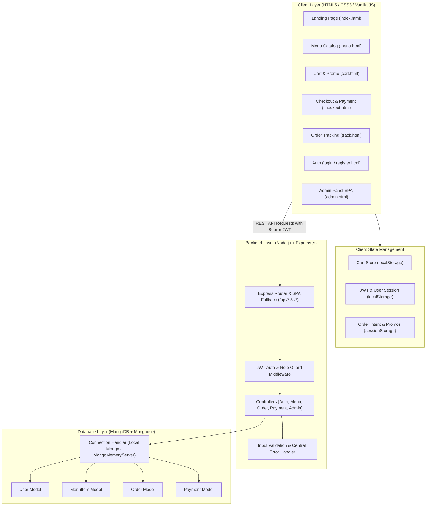
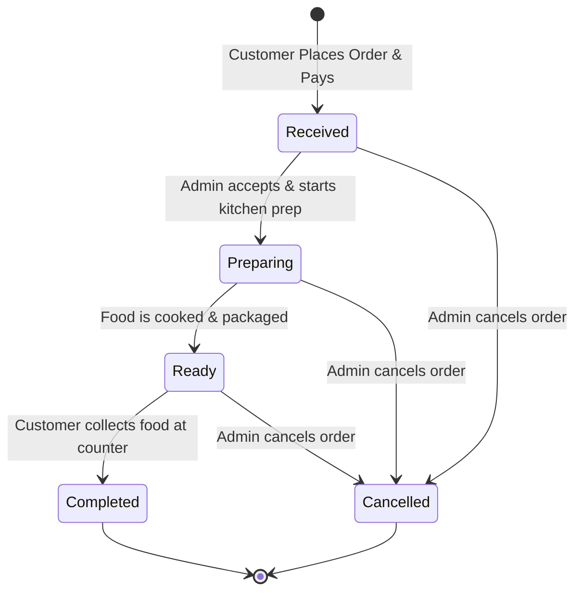

# 🍔 CafeOrder — Online Food Ordering System
## Complete Technical Specification & Project Documentation

---

## 1. Executive Summary

**CafeOrder** is a full-stack cafeteria management and online food ordering system engineered specifically for campus, office, and institutional cafeterias. The platform streamlines the complete food ordering lifecycle:

1. **Customers** can explore an interactive menu categorized by meal types, filter by dietary preference (Vegetarian / Non-Vegetarian), search for dishes, customize order types (Dine-in with table numbers or Pickup), apply promotional discounts, complete simulated online payments (Credit/Debit Card, UPI, or Cash at Counter), and track order preparation status in real time.
2. **Kitchen & Administrative Staff** have access to a centralized, role-protected Admin Dashboard to manage active order queues, transition orders across preparation states, perform full CRUD operations on menu items, monitor customer activity, and analyze sales performance with revenue metrics and payment method breakdowns.

The system is designed with zero-friction onboarding, featuring an automated in-memory MongoDB fallback for instant local execution without requiring a pre-installed database service.

---

## 2. System Architecture & Tech Stack



### Technology Breakdown

| Component | Technology | Version / Details | Purpose |
| :--- | :--- | :--- | :--- |
| **Runtime** | Node.js | v18+ | JavaScript server-side execution runtime |
| **Web Server** | Express.js | `^4.18.2` | REST API routing, static asset delivery, SPA fallback |
| **Database** | MongoDB | v6+ / In-Memory | Document-oriented database engine |
| **ODM** | Mongoose | `^7.6.3` | Schema definition, validation, population, query building |
| **Memory DB** | `mongodb-memory-server` | `^11.2.0` | Development fallback when local mongod is unavailable |
| **Authentication** | JSON Web Tokens (`jsonwebtoken`) | `^9.0.2` | Stateless cryptographic bearer authentication |
| **Password Security**| `bcryptjs` | `^2.4.3` | Salted 12-round cryptographic password hashing |
| **Identifiers** | `uuid` | `^9.0.0` | Generates unique human-readable order and payment IDs |
| **CORS** | `cors` | `^2.8.5` | Cross-Origin Resource Sharing control |
| **HTTP Logger** | `morgan` | `^1.10.0` | Development HTTP request logging |
| **Frontend Core** | HTML5, CSS3, Vanilla JS (ES6+) | Native | Zero-dependency, lightweight, high-performance UI |
| **Typography & Icons** | System Fonts & UTF-8 Emojis | Native | Instant loading with zero external webfont latency |

---

## 3. Directory & File Structure

```
Food-ordering_website/
├── .env                              # Environment variable configuration
├── package.json                      # Project dependencies and script definitions
├── README.md                         # Quick-start instructions and overview
├── PROJECT_DOCUMENTATION.md          # Comprehensive technical documentation
│
├── client/                           # Frontend static assets served by Express
│   ├── index.html                    # Homepage / Cafeteria landing page
│   ├── css/                          # CSS stylesheets (Design system)
│   │   ├── main.css                  # Global variables, typography, reset, buttons, forms, badges
│   │   ├── home.css                  # Hero section, feature grids, call-to-actions
│   │   ├── menu.css                  # Category tabs, veg toggle, grid cards, search bar
│   │   ├── cart.css                  # Cart table, quantity controls, promo code box, order type
│   │   ├── checkout.css              # Multi-step checkout, card/UPI forms, summary drawer
│   │   ├── track.css                 # Live progress stepper, order details card, polling status
│   │   ├── auth.css                  # Authentication card forms (Login & Register)
│   │   └── admin.css                 # Admin sidebar layout, stat cards, data tables, modals
│   ├── js/                           # Client-side JavaScript modules
│   │   ├── utils.js                  # Fetch wrapper (`api`), Toast notifications, Modal helper, `fmt`
│   │   ├── auth.js                   # JWT session manager, `Auth.login`, `Auth.logout`, route guards
│   │   ├── cart.js                   # Singleton `Cart` module backed by `localStorage`
│   │   ├── nav.js                    # Dynamic responsive navbar reflecting auth state
│   │   ├── menu.js                   # Menu catalog rendering, filtering, search, add-to-cart
│   │   ├── cart-page.js              # Cart page view logic, promo calculations, order type storage
│   │   ├── checkout.js               # Form validation, payment method selector, order dispatch
│   │   ├── track.js                  # 15-second polling order tracker, timeline visualizer
│   │   └── admin.js                  # Admin Single Page Application (Dashboard, Orders, Menu, Users, Sales)
│   ├── pages/                        # Individual HTML views
│   │   ├── menu.html                 # Menu browsing page
│   │   ├── cart.html                 # Shopping cart review
│   │   ├── checkout.html             # Order checkout & payment screen
│   │   ├── track.html                # Real-time order progress tracking
│   │   ├── login.html                # Customer / Admin sign-in form
│   │   ├── register.html             # Customer account creation form
│   │   └── admin.html                # Staff / Admin management panel
│   └── images/                       # Static graphics, placeholder images
│
└── server/                           # Backend Node.js / Express codebase
    ├── server.js                     # Server initialization, middleware, routes, auto-seed
    ├── seed.js                       # Database seeding routine (30 dishes, Admin, Customer)
    ├── config/
    │   ├── db.js                     # MongoDB connection with in-memory fallback
    │   └── constants.js              # Tax rate (5%), prep buffer, categories, statuses
    ├── models/
    │   ├── User.js                   # User account schema and password hashing
    │   ├── MenuItem.js               # Dish catalog schema with categories & ratings
    │   ├── Order.js                  # Order schema with snapshot items and timeline
    │   └── Payment.js                # Payment transaction schema with mock gateway details
    ├── controllers/
    │   ├── authController.js         # Register, login, getMe, updateMe, logout
    │   ├── menuController.js         # Menu listing, details, creation, update, deletion, toggle
    │   ├── orderController.js        # Order creation, listing, tracking, status transitions, cancellation
    │   ├── paymentController.js      # Mock gateway simulation, payment initiation, query
    │   └── adminController.js        # Analytics aggregations, revenue stats, user management
    ├── routes/
    │   ├── authRoutes.js             # Routes mapped to `/api/auth`
    │   ├── menuRoutes.js             # Routes mapped to `/api/menu`
    │   ├── orderRoutes.js            # Routes mapped to `/api/orders`
    │   ├── paymentRoutes.js          # Routes mapped to `/api/payments`
    │   └── adminRoutes.js            # Routes mapped to `/api/admin`
    └── middleware/
        ├── auth.js                   # `protect`, `adminOnly`, `optionalAuth` JWT validators
        ├── errorHandler.js           # Central 404 handler and unified JSON error handler
        └── validate.js               # Request payload validation helper functions
```

---

## 4. Database Schema Specifications

### 4.1. User Schema (`server/models/User.js`)

Manages customer and administrator credentials and profiles.

| Field | Type | Constraints / Defaults | Description |
| :--- | :--- | :--- | :--- |
| `name` | String | Required, Trimmed, Max 50 chars | Full name of the user |
| `email` | String | Required, Unique, Lowercase, Regex Match | Primary login identifier |
| `password` | String | Required, Min length 6, `select: false` | Bcrypt-hashed password |
| `phone` | String | Optional, 10-digit numeric regex match | Contact phone number |
| `role` | String | Enum: `['customer', 'admin']`, Default: `'customer'` | Access control role |
| `isActive` | Boolean | Default: `true` | Account activation status |
| `createdAt` | Date | Managed by Mongoose `timestamps` | Account creation timestamp |
| `updatedAt` | Date | Managed by Mongoose `timestamps` | Last modification timestamp |

- **Hooks**: `pre('save')` automatically salts and hashes updated passwords using `bcrypt.hash(password, 12)`.
- **Instance Methods**: `comparePassword(enteredPassword)` compares plaintext against stored hash.

---

### 4.2. MenuItem Schema (`server/models/MenuItem.js`)

Represents cafeteria dishes, drinks, and combos.

| Field | Type | Constraints / Defaults | Description |
| :--- | :--- | :--- | :--- |
| `name` | String | Required, Trimmed, Max 100 chars | Dish name |
| `description` | String | Optional, Max 500 chars | Dish description / ingredients |
| `category` | String | Required, Enum: `Breakfast`, `Lunch`, `Snacks`, `Beverages`, `Desserts`, `Specials` | Menu grouping |
| `price` | Number | Required, Min: 0 | Price in INR (₹) |
| `image` | String | Default: `/images/default-food.png` | Image URL |
| `isAvailable` | Boolean | Default: `true` | Kitchen availability toggle |
| `isVeg` | Boolean | Default: `true` | Dietary classification |
| `preparationTime`| Number | Min: 1, Default: `10` | Estimated preparation duration in minutes |
| `nutrition` | Subdocument | Optional sub-schema | Nutritional profile per serving |
| ↳ `calories` | Number | Min: 0, Default: 0 | Energy content in kcal |
| ↳ `protein` | Number | Min: 0, Default: 0 | Protein content in grams (g) |
| ↳ `carbs` | Number | Min: 0, Default: 0 | Total carbohydrates in grams (g) |
| ↳ `sugar` | Number | Min: 0, Default: 0 | Sugar in grams (g) |
| ↳ `fat` | Number | Min: 0, Default: 0 | Total fat in grams (g) |
| ↳ `saturatedFat` | Number | Min: 0, Default: 0 | Saturated fat in grams (g) |
| ↳ `fiber` | Number | Min: 0, Default: 0 | Dietary fiber in grams (g) |
| ↳ `sodium` | Number | Min: 0, Default: 0 | Sodium in milligrams (mg) |
| ↳ `servingSize` | String | Trimmed string | Portion description (e.g. `1 plate`, `300 ml`) |
| `tags` | [String] | Array of strings | Search tags (e.g. `['popular', 'crispy']`) |
| `ratings.average`| Number | Min: 0, Max: 5, Default: 0 | Average customer rating score |
| `ratings.count` | Number | Default: 0 | Total number of ratings |

- **Indexes**: Compound index `{ category: 1, isAvailable: 1 }` and full-text index `{ name: 'text', description: 'text' }`.

---

### 4.3. Order Schema (`server/models/Order.js`)

Tracks individual orders placed by customers.

| Field | Type | Constraints / Defaults | Description |
| :--- | :--- | :--- | :--- |
| `orderNumber` | String | Unique, Generated: `ORD-XXXXXXXX` | Human-friendly customer reference |
| `customer` | ObjectId | Ref: `'User'`, Required | Reference to the ordering user |
| `customerName` | String | Required | Customer name at time of order |
| `customerPhone`| String | Optional | Customer phone number |
| `items` | Array | Min length 1 | List of ordered items (snapshot subdocuments) |
| ↳ `menuItem` | ObjectId | Ref: `'MenuItem'`, Required | Original item reference |
| ↳ `name` | String | Required | Snapshot of item name |
| ↳ `price` | Number | Required | Snapshot of unit price |
| ↳ `quantity` | Number | Required, Min: 1 | Units ordered |
| ↳ `subtotal` | Number | Required | `price * quantity` |
| `orderType` | String | Enum: `['dine-in', 'pickup']`, Required | Fulfillment preference |
| `tableNumber` | String | Optional, Trimmed | Table number (if `dine-in`) |
| `specialInstructions` | String| Optional, Max 300 chars | Custom prep notes for kitchen |
| `status` | String | Enum: `Received`, `Preparing`, `Ready`, `Completed`, `Cancelled`, Default: `Received` | Current kitchen progress state |
| `statusHistory` | Array | Array of status changes | Audit trail with timestamps and notes |
| `pricing.subtotal`| Number | Required | Sum of items before tax |
| `pricing.tax` | Number | Required | 5% GST calculation |
| `pricing.discount`| Number | Default: 0 | Promotional discount deduction |
| `pricing.total` | Number | Required | Final payable amount |
| `payment` | ObjectId | Ref: `'Payment'` | Linked payment transaction reference |
| `estimatedReadyTime` | Date | Calculated at creation | Expected completion timestamp |

- **Hooks**: `pre('save')` automatically logs the initial `'Received'` state in `statusHistory` upon order creation.

---

### 4.4. Payment Schema (`server/models/Payment.js`)

Records financial transactions processed through the mock gateway.

| Field | Type | Constraints / Defaults | Description |
| :--- | :--- | :--- | :--- |
| `paymentId` | String | Unique, Generated: `PAY-XXXXXXXXXX` | Internal payment identifier |
| `order` | ObjectId | Ref: `'Order'`, Required | Linked order document |
| `customer` | ObjectId | Ref: `'User'`, Required | Customer who initiated payment |
| `amount` | Number | Required, Min: 0 | Paid amount in INR (₹) |
| `method` | String | Enum: `['card', 'upi', 'cash']`, Required | Payment channel |
| `status` | String | Enum: `['pending', 'success', 'failed', 'refunded']`, Default: `'pending'` | Transaction state |
| `transactionId`| String | Generated: `TXN-...` or `CASH-...` | Gateway reference number |
| `gatewayResponse`| Mixed | Default: `{}` | Raw payload simulated from gateway |
| `paidAt` | Date | Populated on success | Completion timestamp |

---

## 5. Comprehensive REST API Reference

Base URL: `http://localhost:3000/api`

### 5.1. Authentication Endpoints (`/api/auth`)

| Method | Endpoint | Auth | Request Body | Response / Details |
| :--- | :--- | :--- | :--- | :--- |
| `POST` | `/api/auth/register` | None | `{ name, email, password, phone? }` | Creates user account, returns signed JWT & user profile |
| `POST` | `/api/auth/login` | None | `{ email, password }` | Validates credentials, returns JWT & user profile |
| `GET` | `/api/auth/me` | Bearer Token | None | Returns profile of currently authenticated user |
| `PUT` | `/api/auth/me` | Bearer Token | `{ name?, phone? }` | Updates profile name or phone number |
| `POST` | `/api/auth/logout` | Bearer Token | None | Client-side logout acknowledgment |

---

### 5.2. Menu Endpoints (`/api/menu`)

| Method | Endpoint | Auth | Query / Body | Response / Details |
| :--- | :--- | :--- | :--- | :--- |
| `GET` | `/api/menu` | None | Query: `?category=`, `?available=`, `?veg=`, `?search=` | Returns array of filtered menu items |
| `GET` | `/api/menu/categories` | None | None | Returns list of available category strings |
| `GET` | `/api/menu/:id` | None | None | Returns single menu item by ID |
| `POST` | `/api/menu` | Admin Only | `{ name, category, price, description?, isVeg?, preparationTime?, image? }` | Adds new item to menu catalog |
| `PUT` | `/api/menu/:id` | Admin Only | Full or partial item fields | Updates existing menu item |
| `DELETE` | `/api/menu/:id` | Admin Only | None | Permanently deletes menu item |
| `PATCH` | `/api/menu/:id/toggle` | Admin Only | None | Inverts the `isAvailable` boolean flag |

---

### 5.3. Order Endpoints (`/api/orders`)

| Method | Endpoint | Auth | Query / Body | Response / Details |
| :--- | :--- | :--- | :--- | :--- |
| `POST` | `/api/orders` | Customer | `{ items: [{ menuItem, quantity }], orderType, tableNumber?, specialInstructions?, customerName, customerPhone? }` | Creates order, resolves DB prices, calculates tax & ETA |
| `GET` | `/api/orders` | Customer / Admin | Query: `?status=`, `?page=`, `?limit=` | Returns paginated orders (own for customers, all for admins) |
| `GET` | `/api/orders/:id` | Customer / Admin | None | Detailed order with populated customer & payment |
| `GET` | `/api/orders/track/:orderNumber` | Public | None | Fast public order lookup for status polling |
| `PATCH` | `/api/orders/:id/status` | Admin Only | `{ status, note? }` | Advances order state (`Preparing`, `Ready`, `Completed`) |
| `DELETE` | `/api/orders/:id` | Admin Only | `{ note? }` | Cancels an order (sets status to `Cancelled`) |

---

### 5.4. Payment Endpoints (`/api/payments`)

| Method | Endpoint | Auth | Request Body | Response / Details |
| :--- | :--- | :--- | :--- | :--- |
| `POST` | `/api/payments` | Customer | `{ orderId, method }` | Executes mock gateway (95% success for Card/UPI, 100% for Cash), attaches to order |
| `GET` | `/api/payments/:id` | Customer / Admin | None | Fetches payment record and linked order |
| `GET` | `/api/payments/order/:orderId` | Customer / Admin | None | Finds payment associated with a given order ID |

---

### 5.5. Admin & Analytics Endpoints (`/api/admin`)

| Method | Endpoint | Auth | Query Params | Response / Details |
| :--- | :--- | :--- | :--- | :--- |
| `GET` | `/api/admin/dashboard` | Admin Only | None | Aggregated counts, active orders, today's revenue, recent orders, top 5 items |
| `GET` | `/api/admin/orders` | Admin Only | `?status=`, `?date=YYYY-MM-DD`, `?page=`, `?limit=` | Filterable order management table with pagination |
| `GET` | `/api/admin/users` | Admin Only | None | List of all registered customer accounts |
| `PATCH` | `/api/admin/users/:id/toggle` | Admin Only | None | Toggles `isActive` flag to activate/suspend user |
| `GET` | `/api/admin/analytics/sales` | Admin Only | `?from=YYYY-MM-DD`, `?to=YYYY-MM-DD` | Aggregated daily sales revenue and revenue broken down by payment method |

---

### 5.6. System & Health (`/api/health`)

| Method | Endpoint | Description |
| :--- | :--- | :--- |
| `GET` | `/api/health` | Returns server health status, environment mode, and current server timestamp |

---

## 6. Business Logic & Calculation Rules

### 6.1. Financial Calculations

- **Subtotal Calculation**:
  $$\text{Subtotal} = \sum (\text{Price}_{\text{item}} \times \text{Quantity}_{\text{item}})$$
  *Note: Item prices are read directly from the database at order placement time to prevent client-side price tampering.*
- **Tax Calculation (GST)**:
  $$\text{Tax} = \text{round}(\text{Subtotal} \times 0.05, 2) \quad (5\% \text{ GST})$$
- **Promotional Discounts**:
  Client demo promo codes deduct percentage amounts prior to checkout:
  - `CAFE10`: 10% discount
  - `FIRST20`: 20% discount
  - `STUDENT5`: 5% discount
- **Total Payable**:
  $$\text{Total} = \text{round}(\text{Subtotal} + \text{Tax} - \text{Discount}, 2)$$

### 6.2. Estimated Preparation Time Calculation

The system dynamically estimates when an order will be ready for pickup:
$$\text{MaxPrepTime} = \max(\text{item.preparationTime for item in Order})$$
$$\text{EstimatedReadyTime} = \text{Now} + (\text{MaxPrepTime} + \text{DEFAULT\_PREP\_BUFFER}) \times 60 \text{ seconds}$$
*Where `DEFAULT_PREP_BUFFER` is set to 5 minutes.*

### 6.3. Order Lifecycle State Machine



- When an order reaches a terminal state (`Completed` or `Cancelled`), client-side polling automatically halts.

---

## 7. Frontend User Journey & Interface Modules

### 7.1. Public & Customer Workflow

1. **Landing Page (`/`)**:
   - Hero banner with quick links to explore menu.
   - Highlights cafeteria features: Speedy preparation, hygienic food, zero waiting lines.
2. **Menu Catalog (`/menu` or `pages/menu.html`)**:
   - Filter by categories: `Breakfast`, `Lunch`, `Snacks`, `Beverages`, `Desserts`, `Specials`.
   - Dietary filter: Pure Veg toggle.
   - Instant search bar filtering by name or description.
   - Interactive item cards with item image, price, prep time badge, and one-click "Add to Cart" with quantity selector.
3. **Shopping Cart (`/cart` or `pages/cart.html`)**:
   - Dynamic table of chosen items with unit price, increment/decrement controls (capped at 20 units per item), and removal.
   - Order type selector: **Dine-in** (with optional Table Number) or **Pickup**.
   - Promo code input with instant validation and discount breakdown.
   - Live summary showing Subtotal, 5% Tax, Discount, and Total.
4. **Checkout & Payment (`/checkout` or `pages/checkout.html`)**:
   - Auth Guard: Redirects to login if user is unauthenticated, preserving cart data.
   - Customer details: Auto-fills name and phone from authenticated user profile.
   - Special kitchen instructions field.
   - Payment method toggle:
     - **Credit / Debit Card**: Form with 16-digit spacing, MM/YY expiry formatting, 3-digit CVV validation.
     - **UPI**: UPI ID validation (checks for valid `@` handle).
     - **Cash at Counter**: Instant checkout with order number generation.
   - Processing modal with animated spinner to simulate gateway authorization.
   - Confirmation receipt with order reference number and direct link to track order.
5. **Real-time Order Tracker (`/track` or `pages/track.html`)**:
   - Search by Order Number (e.g., `ORD-XXXXXXXX`).
   - Auto-tracks the most recent order from the current browser session.
   - Visual 4-step progress bar: `Received` $\rightarrow$ `Preparing` $\rightarrow$ `Ready` $\rightarrow$ `Completed`.
   - Polling engine: Queries `/api/orders/track/:orderNumber` every 15 seconds.
   - Audio / Visual cues when status changes to "Ready for Pickup".

---

### 7.2. Administrator Workflow (`/admin` or `pages/admin.html`)

Access is restricted exclusively to authenticated users with `role: "admin"`. The panel operates as a responsive Single Page Application with 5 primary sections:

1. **Dashboard Overview**:
   - Metric cards: Total Orders, Today's Orders, Active Orders In-Kitchen, Today's Revenue, Active Menu Items, Total Customers.
   - Active orders counter badge.
   - Recent orders log with quick status badges.
   - Top 5 best-selling menu items ranked by volume and revenue.
2. **Orders Management**:
   - Real-time kitchen board with all active and historical orders.
   - Filters by status (`Received`, `Preparing`, `Ready`, `Completed`, `Cancelled`) and date picker.
   - One-click status advancement (e.g. advance from `Received` to `Preparing`, or `Preparing` to `Ready`).
   - Order cancellation modal with reason note.
3. **Menu Management**:
   - Grid and list view of all cafeteria menu items.
   - Instant toggle switch to mark items "In Stock" or "Sold Out" (reflects immediately on customer menu).
   - "Add New Item" modal form with image URL, prep time, veg/non-veg flag, and category selector.
   - Edit item and Delete item actions.
4. **Customer Directory**:
   - Roster of all registered customer accounts with name, email, phone, and registration date.
   - Account status toggle: Deactivate or reactivate customer accounts.
5. **Sales Analytics**:
   - Custom date-range financial reporting (`from` / `to`).
   - Daily revenue breakdown.
   - Revenue distribution by payment method (Card vs. UPI vs. Cash).

---

## 8. Security & Quality Assurance

- **Cryptographic Password Hashing**: Passwords are never stored in plaintext. They are salted and hashed using `bcryptjs` with 12 rounds of hashing.
- **JWT Protection**:
  - Tokens are signed with an HMAC SHA-256 secret (`JWT_SECRET`) and carry a configurable TTL (`7d`).
  - Auth middleware checks the `Authorization: Bearer <token>` header, decodes the user ID, verifies account activation status, and rejects expired or tampered signatures.
- **Double-Layered Route Guards**:
  - Sensitive administrative endpoints require two middlewares in series: `protect` (verifies valid token) followed by `adminOnly` (asserts `req.user.role === 'admin'`).
- **NoSQL Injection Defense**: All database operations use Mongoose typed model schemas which sanitize queries and reject unescaped operators.
- **Input Validation**: Central validation routines (`validateRegister`, `validateLogin`, `validateOrder`, `validateMenuItem`, `validatePayment`) sanitize strings, enforce length limits, and validate regex patterns for emails and 10-digit phone numbers before hitting controllers.
- **Zero-Crash Graceful Shutdown**: `server.js` listens for `SIGTERM` and `SIGINT` signals, closing HTTP listeners and database handles cleanly.

---

## 9. Environment Configuration & Setup Guide

### 9.1. Environment Variables (`.env`)

| Variable | Default Value | Description |
| :--- | :--- | :--- |
| `PORT` | `3000` | Port on which Express server listens |
| `MONGO_URI` | `mongodb://localhost:27017/food_ordering` | Primary MongoDB connection URI |
| `JWT_SECRET` | `cafeteria_secret_key_2024` | Secret string used for signing authentication JWTs |
| `JWT_EXPIRES_IN` | `7d` | Token expiration duration |
| `SESSION_SECRET` | `cafeteria_session_secret` | Session secret identifier |
| `NODE_ENV` | `development` | Environment mode (`development` or `production`) |
| `ADMIN_EMAIL` | `admin@cafeteria.com` | Email address for default administrator account |
| `ADMIN_PASSWORD` | `Admin@123` | Password for default administrator account |

### 9.2. Installation & Run Instructions

```bash
# 1. Navigate to the project directory
cd Food-ordering_website

# 2. Install dependencies
npm install

# 3. (Optional) Run standalone database seed or nutrition upgrade
npm run seed
npm run seed:nutrition

# 4. Start the application
# For production execution:
npm start

# For development with nodemon auto-reload:
npm run dev
```

### 9.3. Out-of-the-Box Demo Accounts

The project includes an automatic database seeding feature. If the database is empty, it populates 30 distinct menu items across all 6 categories and provisions two testing accounts:

| User Type | Email | Password | Access Privileges |
| :--- | :--- | :--- | :--- |
| **Administrator** | `admin@cafeteria.com` | `Admin@123` | Full access to `/admin` dashboard, order state machine, menu CRUD, user toggles |
| **Customer** | `customer@example.com` | `Customer@123` | Order placement, cart, payment simulation, order history & tracking |

---

## 10. Summary Matrix

| Feature | Implementation | Customer Impact | Staff Impact |
| :--- | :--- | :--- | :--- |
| **Zero-Config DB** | `mongodb-memory-server` fallback | Instant application availability | Zero developer / admin maintenance |
| **Dietary Filtering** | Category tabs + Veg switch | Effortless meal discovery | Fewer order errors and kitchen queries |
| **Live Tracking** | 15s REST polling stepper | Eliminates physical queues at counter | Reduced counter congestion |
| **Mock Gateway** | Card, UPI, and Cash simulation | Realistic checkout experience | Real-time payment reconciliation |
| **Admin Panel** | Multi-view SPA | Transparent order processing | Full kitchen and menu autonomy |
